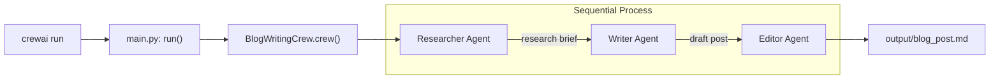
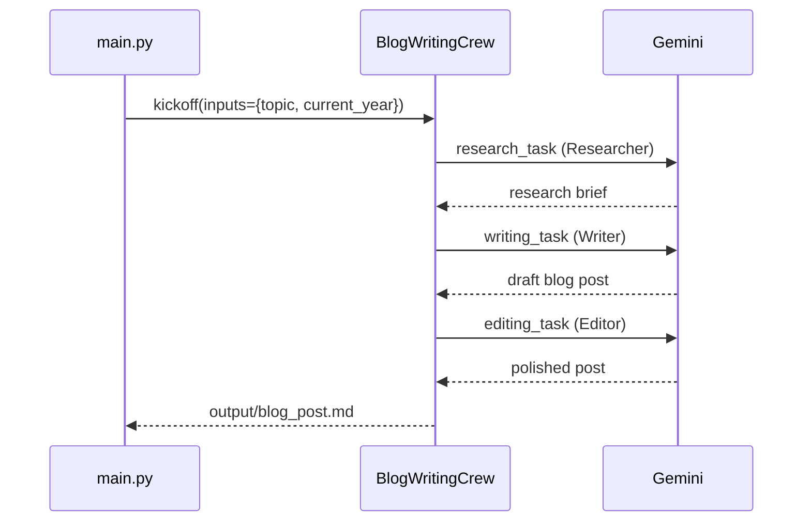
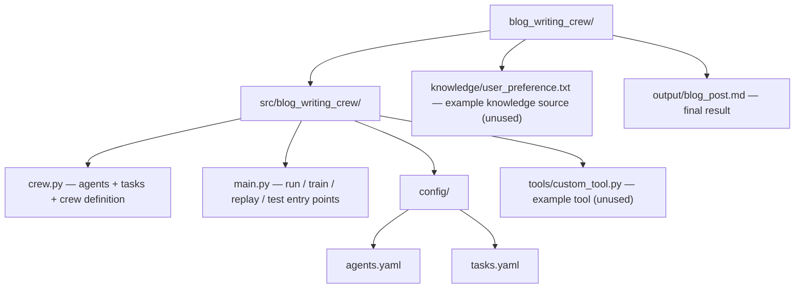
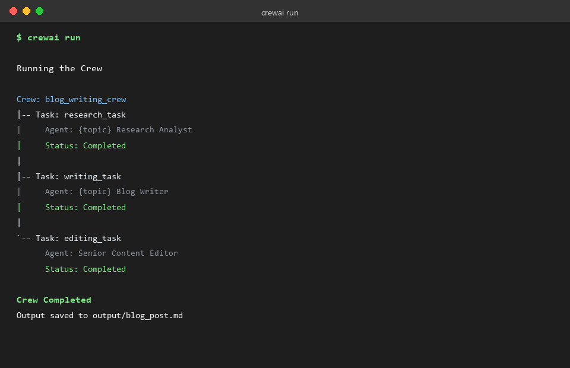
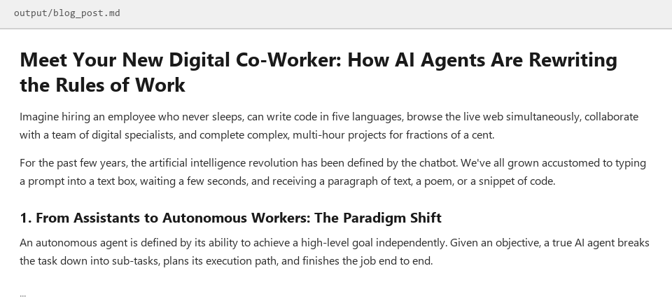

# BlogWritingCrew

A multi-agent AI system, built with [crewAI](https://crewai.com), that turns a single topic into a polished blog post. Three agents — a researcher, a writer, and an editor — work one after another, each handing its output to the next.

## How it was built

The project started from the standard `crewai create crew` template and was shaped into a 3-agent pipeline:

- **`config/agents.yaml`** — defines each agent's role, goal, and backstory (Researcher, Writer, Editor)
- **`config/tasks.yaml`** — defines what each agent has to do and what "done" looks like
- **`crew.py`** — wires agents to tasks and runs them as a `Process.sequential` crew
- **`main.py`** — the entry point `crewai run` calls, with a hardcoded `topic` input
- **LLM** — Google Gemini, configured entirely through `.env` (`MODEL=gemini/...` + `GEMINI_API_KEY`), no code changes needed

### Architecture



### Task pipeline



### Project structure



## Example output

Running `crewai run` executes the researcher → writer → editor pipeline:



...and writes the final result to `output/blog_post.md`:



## Installation

Requires Python `>=3.10 <3.14`. Dependencies are managed with [uv](https://docs.astral.sh/uv/).

```bash
pip install uv
crewai install
```

### Configuration

Add to `.env`:

```
MODEL=gemini/gemini-flash-lite-latest
GEMINI_API_KEY=your-key-here
```

- Edit `src/blog_writing_crew/config/agents.yaml` to change agent roles/goals
- Edit `src/blog_writing_crew/config/tasks.yaml` to change what each task asks for
- Edit `src/blog_writing_crew/main.py` to change the `topic` input

## Running the project

```bash
crewai run
```

This runs the researcher → writer → editor pipeline and writes the final post to `output/blog_post.md`.

## Support

- [crewAI documentation](https://docs.crewai.com)
- [crewAI GitHub](https://github.com/joaomdmoura/crewai)
